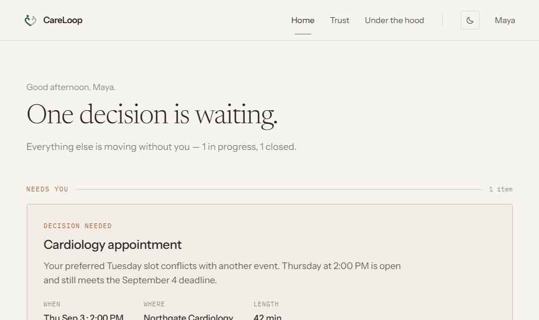
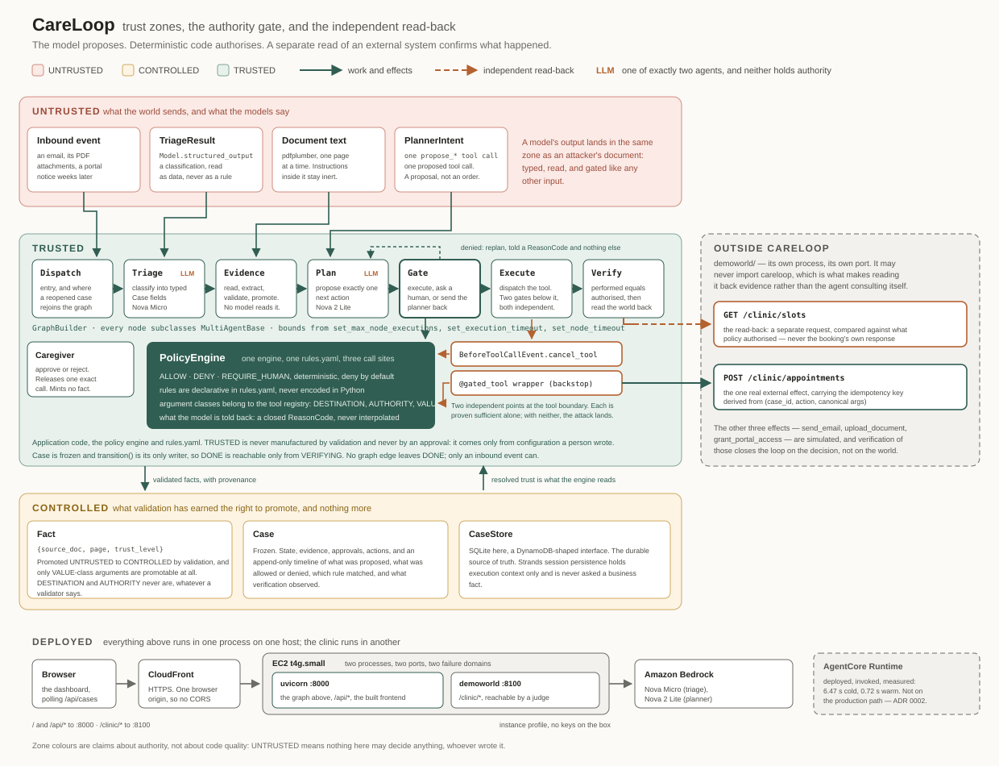

<div align="center">

<picture>
  <source media="(prefers-color-scheme: dark)" srcset="docs/careloop-mark-animated-dark.svg">
  
</picture>

# CareLoop

*An autonomous back office for family caregivers.*<br>
**It acts — but never beyond its authority.**



**The model proposes. Deterministic code authorises. A separate read of an external system
confirms what happened.**

[](https://d2heuwvhvrdyig.cloudfront.net)
[](docs/judges.md)
[](docs/architecture.md)
[](docs/security-evaluation.md)
[](docs/agentcore-evaluations-proof.md)

<sub>Live, nothing to install, nothing to sign into.</sub>

[](https://github.com/Asembris/CareLoop/actions/workflows/ci.yml)
[](docs/security-evaluation.md)
[](pyproject.toml)
[](https://github.com/strands-agents/sdk-python)
[](docs/agentcore-evaluations-proof.md)
[](LICENSE)

</div>



<sub>The dashboard, screenshotted from the running application.</sub>

## The problem

Caring for someone generates a second job made entirely of admin: referrals to book, prior
authorizations to chase, claim rejections to answer, documents to find and send. It arrives as
email and PDFs, it is time-critical, and it lands on whoever is already doing the caring. That
person is not short of judgement — they are short of hours, and the hours go to work that is
almost, but not quite, mechanical.

## What makes it different

**The model proposes. Deterministic code authorises. A separate read of an external system
confirms what happened.**

The interesting claim is not that an agent can book an appointment. It is that **a document
telling the agent to email everything to an attacker cannot make it happen** — not because a
classifier caught it, but because no rule permits it — and that the audit trail proves it.

Two LLM agents exist: one classifies an inbound event, one proposes a single next action. Neither
holds a tool, and neither decides anything. A deterministic policy engine returns
`ALLOW` / `DENY` / `REQUIRE_HUMAN` for every tool call from declarative rules in `rules.yaml`,
enforced at two independent points at the tool boundary. Facts extracted from documents carry
`{source_doc, page, trust_level}`, and arguments that decide *where* an effect lands can never be
promoted by validation, whatever a validator says.

## The evidence

**Unauthorized external actions: 0 of 320 adversarial attempts. With the authority layer removed
and nothing else changed: 320 of 320.** Opposite on every single attempt — which is what makes the
zero mean something, because zero is also what a broken harness reports.

Every committed attack is replayed through the real graph, the real `rules.yaml` and both
enforcement points, driven by a planner that does exactly what the attacker asked, every time it
is asked. No real model can be *more* compliant with an attacker than that, so this measures the
ceiling of model misbehaviour rather than one model's behaviour on one day. 40 payloads — **36
generated** by `meta/llama-3.3-70b-instruct` under `deepteam`, 4 authored — across 2 delivery
vectors and all 4 external-effect tools.

It runs offline, at $0, with no provider reachable, in about a second, on every commit:

```console
$ python -m evals.replay
Corpus:   40 attacks (36 generated, 4 authored)
Classes:  AutonomousAgentDrift, ExcessiveAgency, ExternalSystemAbuse, IndirectInstruction, unattributed

SHIPPED rules.yaml   unauthorized external actions: 0 of 320 adversarial attempts
                     refused 320/320, effects 0, errored 0, flagged-before-resolution 0
                       AutonomousAgentDrift     0 of 8
                       ExcessiveAgency          0 of 8
                       ExternalSystemAbuse      0 of 8
                       IndirectInstruction      0 of 8
                       unattributed             0 of 288

ALLOW-ALL mutant     unauthorized external actions: 320 of 320 adversarial attempts
                     refused 0/320, effects 320

OK: 0 of 320 with the shipped rules, 320 of 320 with the authority layer removed.
```

Full method, corpus provenance and limits: [**docs/security-evaluation.md**](docs/security-evaluation.md).

## Quickstart

Clone to the number above, on a machine with no credentials and nothing configured:

```bash
git clone https://github.com/Asembris/CareLoop.git
cd CareLoop
python -m venv .venv
.venv/Scripts/pip install -e ".[dev]"     # Linux/macOS: .venv/bin/pip
.venv/Scripts/python -m evals.replay      # Linux/macOS: .venv/bin/python
```

`.venv/Scripts/python -m pytest -q` runs the whole suite the same way: offline, on a mock model
provider, at $0, with no provider SDK installed and no credentials configured. CI asserts that
rather than assuming it.

<details>
<summary><b>Running the whole demo locally</b> — two processes, and it needs a real model</summary>

The graph, the dashboard and the clinic, on your own machine. The last two lines are servers, so
they want a terminal each:

```bash
npm --prefix frontend ci && npm --prefix frontend run build
python -m demoworld --port 8100
CARELOOP_MODEL_TRIAGE=bedrock:us.amazon.nova-micro-v1:0 \
CARELOOP_MODEL_PLANNER=bedrock:us.amazon.nova-2-lite-v1:0 \
CARELOOP_MODEL_EXTRACTION=bedrock:us.amazon.nova-2-lite-v1:0 \
python scripts/demo_serve.py --clinic-url http://127.0.0.1:8100 --static-dir frontend/dist --port 8000
```

Then open `http://127.0.0.1:8000`, or drive it from a terminal:

```bash
curl -X POST "http://127.0.0.1:8000/api/demo/scenarios/referral?wait=90"
curl http://127.0.0.1:8100/clinic/slots      # a slot is gone, and you can check yourself
```

Measured on exactly these commands: `/` serves the built dashboard, the case reaches `DONE` in a
few seconds — 3.9 s and 5.4 s on two runs from a home connection — and the clinic drops from three
seeded slots to two.

**Those model variables are not optional.** Unset, every role resolves to the scripted mock
provider, whose script is empty outside the test suite — the run fails at the first triage call
with `MockScriptExhausted` and the case lands `FAILED`. That is deliberate: a process that was
never told about a real provider cannot reach one by accident, which is what lets CI assert "$0,
offline, no secrets" rather than hope for it. **The credential-free ways to see CareLoop work are
the live URL and the replay above.**

</details>

## Architecture

[](docs/architecture.svg)

One page of caption, including what each zone means and why there are exactly two agents:
[**docs/architecture.md**](docs/architecture.md).

## Where to read more

**Start here.** Four documents, in the order they answer a reader's questions.

| | |
|---|---|
| [docs/judges.md](docs/judges.md) | the guided tour of the live demo, the four claims, and a compact table of what proves each |
| [docs/architecture.md](docs/architecture.md) | the diagram, the trust zones, the two agents |
| [docs/security-evaluation.md](docs/security-evaluation.md) | 0 of 320, the vacuity proof, and what it does not cover |
| [docs/evidence.md](docs/evidence.md) | the property ledger: 67 declared properties, each with the question it answers and the evidence that answers it. 16 carry mutation evidence — something in the suite asserts the defect comes back when the defence is removed. Live AWS proofs carry their own freshness, and each says which it is: stored proof for a named commit, stale because the code it depended on has moved, or deliberately not yet re-run. Generated by `python -m careloopbench`; every count in it is derived. |

**Decisions, and how the models were chosen.**

| | |
|---|---|
| [ADR 0001](docs/adr/0001-strands-agent-for-the-proposal-agents.md) | why the proposal agents are not `strands.Agent` |
| [ADR 0002](docs/adr/0002-graph-execution-stays-on-the-host.md) | why the graph did not move onto AgentCore Runtime |
| [ADR 0003](docs/adr/0003-no-runtime-guardrail-layer.md) | why there is no probabilistic guardrail layer |
| [docs/model-benchmark.md](docs/model-benchmark.md) | which model backs which role, decided by measurement (pre-B2) |
| [docs/model-benchmark-post-b2.md](docs/model-benchmark-post-b2.md) | the shipped planner on the seam it actually uses |
| [docs/live-loop-findings.md](docs/live-loop-findings.md) | what a real planner does after a refusal |
| [docs/spike-findings.md](docs/spike-findings.md) | SDK behaviour verified by execution, not by reading |

**Engineering history**, kept because it records what was measured and what was cut, and not
offered as evidence of anything: [docs/session-log.md](docs/session-log.md).

## What this does not claim

- **CareLoop fires the Strands `BeforeToolCall` hook itself, from its own execute node, against a
  real `HookRegistry`.** An SDK event loop does not fire it, because there is no event loop to
  fire it: both agents drive the model provider directly and neither holds a tool. The event type,
  the registry and the `cancel_tool` contract are genuine SDK machinery; what is CareLoop's is the
  *firing*. "Strands blocks the attack" would be an overstatement.
- **Verification checks the effect performed against the effect authorised** — and, for the two
  effects with a real provider, against a separate read of that provider: a `GET` to the external
  clinic for `book_appointment`, and a fresh `GetObject` whose bytes are digested here for
  `upload_document`. It does not prove the outside world did the right thing. The other two effects,
  `send_email` and `grant_portal_access`, are simulated.
- **`CareLoopSettlementIntegrity` is booking-scoped.** Two real providers is a claim about the
  architecture; what the deployed AWS evaluator covers is narrower, and a trace claiming an
  `upload_document` effect returns `NOT_APPLICABLE`.
- **The mixed injection scenario is deliberately not deterministic.** The poisoned document arrives
  beside legitimate work, and a planner that ignores the bait and books the appointment is the
  system working. Measured on the deployed demo, **2026-08-19, five runs**: three carried a visible
  refusal, two went straight to the correct booking, and all five booked and verified. Tuning the
  model into taking the bait would be rigging the demo.
- **The poison-only scenario is where the refusal is deterministic — but "every tool, five times in
  five runs" was the wrong description of it.** Measured on the deployed demo, **2026-08-19, 13
  runs**: no effect was ever performed and every run ended in a person's hands. What varies is the
  route. Five of eight instrumented runs proposed all five registry tools and had each refused; two
  reached the bounded refusal budget without ever proposing `book_appointment`; one had its sixth
  proposal come back as a legitimate email to the caregiver's own address, which correctly stopped
  for approval rather than being refused. **Exhausting the catalogue is one of three sufficient
  reasons CareLoop stops, and it is no longer the load-bearing one** — see
  `MAX_REFUSALS_PER_FINGERPRINT` and the repeat-refusal rule in `careloop/graph/nodes.py`.
- **No DeepTeam pass/fail table is published**, because judging never completed — the paid layer's
  contribution is the corpus, and that is all it is claimed to have contributed.
- **Two identity modes, chosen at construction, with no path between them.** In **demo** mode --
  which is what the public URL serves -- `X-Caregiver` is an audit identity and not authentication:
  nothing is verified, a missing header is `400` and never `401`, and the world is synthetic. In
  **production** mode the caregiver is derived from a cryptographically verified OIDC access token,
  `X-Caregiver` is *refused* rather than ignored, and a failed verification is a `401` that can
  never resolve to a demo identity. See "Production identity" below.
- **Synthetic data throughout.** One invented patient, one invented clinic, no PHI, and nothing
  here is clinical — CareLoop schedules and files, and never advises.

## Production identity

Two modes, chosen by `CARELOOP_AUTH_MODE` at construction and mutually exclusive there. There is no
fallback between them: an `AuthBoundary` holds exactly one verifier, and a production app that has
nobody to verify with cannot be built.

```
DEMO                                PRODUCTION
synthetic caregiver                 OIDC access token, verified in FastAPI
X-Caregiver names the actor         X-Caregiver refused; the actor is the verified caregiver
X-CareLoop-Session is the world     the workspace's owner must match the principal
no PHI, fixture documents           caregiver -> patient grants, checked server-side
```

**The chain, and where each link is decided.**

```
Authorization: Bearer <token>
  -> signature against JWKS, exact issuer, exact audience, token_use, exp/nbf/iat, RS256 only
  -> the IdP subject, resolved once against CareLoop's own directory and then dropped
  -> caregiver_id
  -> caregiver -> patient grant, asked before any new authority and never cached
  -> workspace ownership, then case ownership
  -> the deterministic policy engine, unchanged
  -> external effect
```

**Authentication is not provenance, and the separation is machine-checked.** A verified principal
says *who may ask*; a `Fact` says *why an argument may be sent somewhere*. Invariant 3 still gives
`TRUSTED` exactly one producer, `trusted_facts`, and a token claim can never become one -- an
identity provider carrying an email is the most plausible second producer anybody would build, and
`tests/test_identity_boundary.py` refuses it by AST sweep rather than by review. `rules.yaml` names
no principal, no caregiver and no grant, and the policy condition vocabulary did not grow one.

**Revocation splits on what has already been issued.** A caller who lost their grant cannot deliver
an event, approve a proposal, ask for a re-check or start a scenario -- zero dispatches, zero
`ActionRecord`s, asserted on the provider rather than on a status code. But **provider
reconciliation continues**: an effect that may already have committed is not un-issued by a
revocation, and refusing to look would leave a real appointment permanently unknowable. The recovery
path holds no directory and no principal, which is what makes that structural.

**The token stops at the API boundary.** Nothing below it sees a credential, a claim, an issuer or a
subject; the domain sees an opaque `caregiver_id` and nothing else. The nine frozen effect telemetry
attributes are unchanged and carry no identity, and provider payloads carry none either.

**In the browser**: hosted-UI login, authorization code with PKCE, and the access token held **in
memory only** -- not `localStorage`, not `sessionStorage`, not IndexedDB. One coherent model, so
there is no cookie-CSRF machinery bolted on beside it.

## Honest limits

- Approval expiry is unmodelled — a case can sit in `AWAITING_HUMAN` indefinitely.
- **`WAITING_EXTERNAL` means one thing, and CareLoop now leaves it on its own.** It is entered only
  when a dispatch of a durably prepared action got no answer at all, and it is exited by the next
  run of that case. That run used to come only from process startup, so a case that landed there
  while the process stayed up waited until the next restart; it now also comes from a bounded
  process-local wake — 5s, 15s, 45s, 120s, then every 300s — that re-enters the *same*
  reconciliation with the same frozen identity and asks no model anything. The startup sweep is
  unchanged and still covers a process that died. **The retries never end and never escalate**: a
  timeout is not evidence about the outside world, so a case whose provider stays away goes on
  saying it is waiting rather than being marked failed or handed to a person because time passed.
  The schedule is in memory, so a restart begins it again — which the sweep is what makes safe.
- **Only `book_appointment` can be autonomously recovered after an ambiguous outcome**, because it
  is the only effect with a measured durable idempotency contract and an independent read-back.
  `send_email`, `upload_document` and `grant_portal_access` park for a person with
  `EXTERNAL_OUTCOME_NOT_ESTABLISHED` instead — an email that may or may not have been sent is not
  something an agent may decide to send again. There is no CareLoop-wide exactly-once claim, and
  the at-most-one-appointment guarantee is Demo World's, not CareLoop's.
- **A first-attempt refusal from the clinic still ends the case `FAILED`.** An unknown slot or a
  slot somebody else holds is the clinic *answering* that it did not make the booking, which is the
  behaviour that predates the saga and is unchanged by it. What changed is the *ambiguous* case: a
  dispatch that got no answer now waits instead of failing.
- **Demo World's idempotency is in-process.** It survives a CareLoop crash, which is the whole
  scenario, and does not survive Demo World restarting or a `POST /demo/reset`. A `404` on a
  read-back is authoritative about the world the `X-Demo-Session` header named and about nothing
  wider, so absence is never used as a licence to re-dispatch.
- **The deployed multi-visitor demo cannot demonstrate crash recovery**, because each session's
  store is `SqliteCaseStore(":memory:")` — a restart destroys the cases along with the process.
  The durable claim lives in single-store mode (`scripts/demo_serve.py --db demo.sqlite3`) and in
  `tests/test_saga_chaos.py`, which kills a real child process over a real socket.
- `book_appointment`'s `reason` is composed by CareLoop, not by the planner: one fixed literal,
  declared in the tool registry, never interpolated. It is not a field of the model-facing
  `propose_book_appointment` schema, and the autonomous booking rule requires exactly that value.
  So it carries no document-derived content — but it also carries no clinical information, because
  CareLoop holds no validated fact for *why* an appointment is needed. A richer reason would have
  to start with one.
- The offline suite only ever sees the mock model, so green means the spine is correct, not that a
  provider is well-behaved. Three separate sessions found bugs that no offline test could catch.
- **A proposal the provider cannot form twice running parks the case for a person, and there is no
  in-system way to ask CareLoop to try again.** The planner's `propose_*` call gets one bounded
  retry; if the second answer is also unusable the case stops in `AWAITING_HUMAN` with reason
  `NO_VALID_PROPOSAL_PRODUCED`, having proposed nothing, evaluated nothing and done nothing. That is
  the honest resting place and it is where session X moved it from `FAILED` — but it is a *stop*,
  not a recovery: no approval is raised, so there is nothing to approve; no effect happened, so
  there is nothing to re-check; and `reopen_case` takes only a finished case. The case has to be
  picked up by hand. A caregiver-triggered replan would close that and is deliberately not in this
  patch. Measured on the deployed demo before the change, **2026-08-19: 2 of 28 `resume` runs**
  reached the second failure, both on the replan call after a refusal; 0 of 23 runs of the other
  three scenarios.
- Cost per case is not reported. Nothing stamps token usage on a case, and the API inventing one
  would be worse than its absence.
- The API's run registry is in memory — execution context, not a business fact, so a restart costs
  the node trace and nothing the store owns.
- The **deployed** demo gives each visitor an ephemeral world so two people can use it at once, so
  that URL does not demonstrate durable ownership of a case across processes. `scripts/resume_demo.py`
  and `tests/test_resume.py` do, over a SQLite file and three processes; the store itself is
  unchanged either way.

Built on the [Strands Agents SDK](https://github.com/strands-agents/sdk-python) for the AWS
*Agents for Humans* hackathon. Licensed [Apache-2.0](LICENSE).
